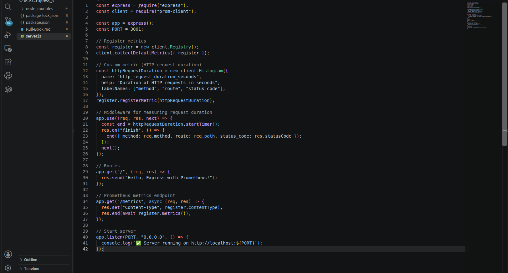
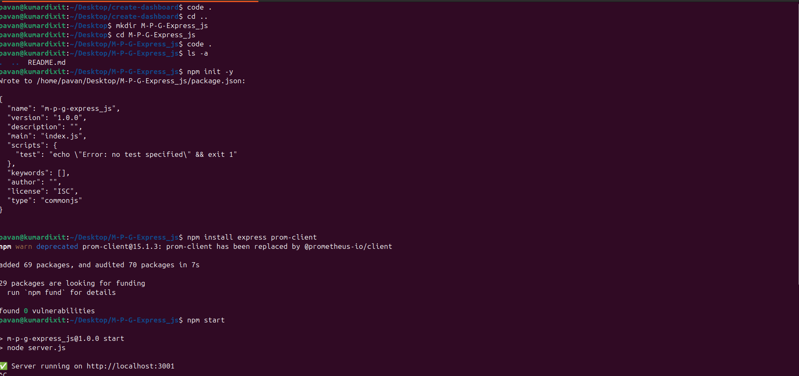
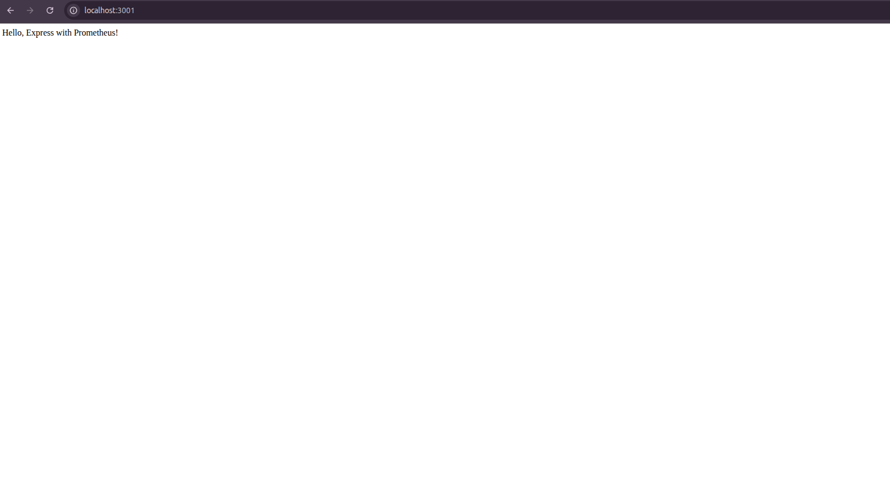
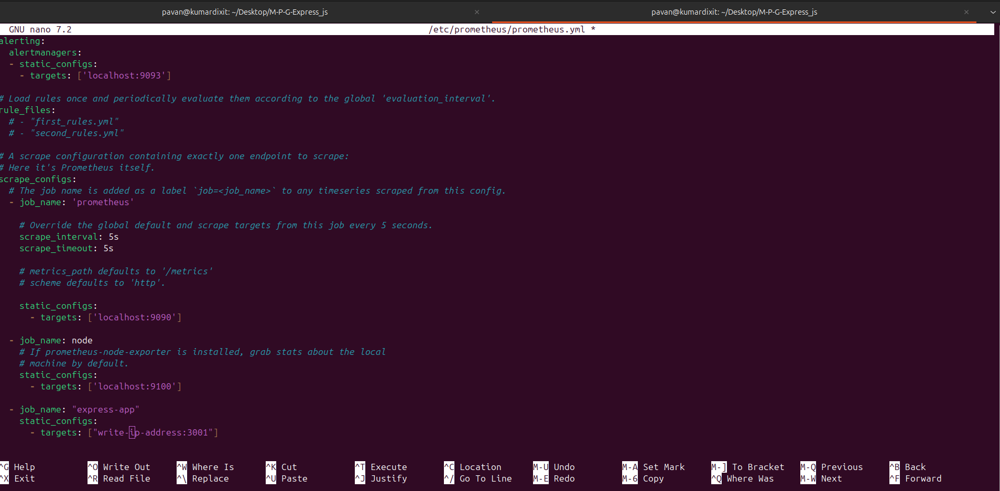
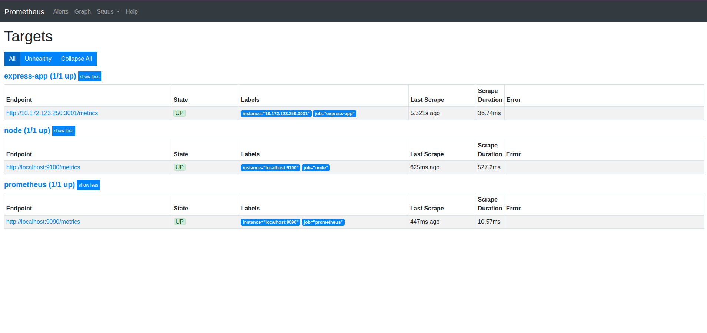
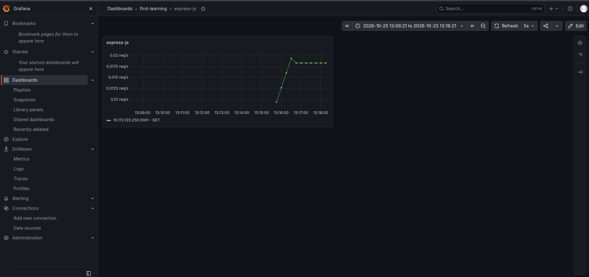

# 🚀 Monitor Express JS App using Prometheus & Grafana

A **complete beginner-friendly guide** to monitor your Express.js application with **Prometheus** and **Grafana**. This step-by-step tutorial will help you set up metrics collection, expose them via an endpoint, and visualize them in Grafana.

---

## 📌 Prerequisites
Before starting, make sure you have:
- **Node.js** and **npm** installed
- **Prometheus** installed and running
- **Grafana** installed and running

---

## ⚡ Step 1: Initialize Node.js Project
Open your terminal and run:

```bash
mkdir express-prometheus-grafana
cd express-prometheus-grafana
npm init -y
npm install express prom-client
```
### Application Running Locally

---

## ⚡ Step 2: Create Express Server with Prometheus Metrics
Create a file named **`server.js`** and add the following code:

```javascript
const express = require("express");
const client = require("prom-client");

const app = express();
const PORT = 3001;

// Register metrics
const register = new client.Registry();
client.collectDefaultMetrics({ register });

// Custom metric (HTTP request duration)
const httpRequestDuration = new client.Histogram({
  name: "http_request_duration_seconds",
  help: "Duration of HTTP requests in seconds",
  labelNames: ["method", "route", "status_code"],
});
register.registerMetric(httpRequestDuration);

// Middleware for measuring request duration
app.use((req, res, next) => {
  const end = httpRequestDuration.startTimer();
  res.on("finish", () => {
    end({ method: req.method, route: req.path, status_code: res.statusCode });
  });
  next();
});

// Routes
app.get("/", (req, res) => {
  res.send("Hello, Express with Prometheus!");
});

// Prometheus metrics endpoint
app.get("/metrics", async (req, res) => {
  res.set("Content-Type", register.contentType);
  res.end(await register.metrics());
});

// Start server
app.listen(PORT, "0.0.0.0", () => {
  console.log(`✅ Server running on http://localhost:${PORT}`);
});
```

### Application Server Implementation




Run the server:

```bash
npm start
```
### Terminal and Setup



### Application Running Locally



### Node.js Application with Metrics


👉 Open in browser: [http://localhost:3001/metrics](http://localhost:3001/metrics) to see Prometheus metrics.

---

## ⚡ Step 3: Configure Prometheus
Open Prometheus configuration file:

```bash
sudo nano /etc/prometheus/prometheus.yml
```

Add the following job:

```yaml
scrape_configs:
  - job_name: "express-app"
    static_configs:
      - targets: ["<your-system-ip>:3001"]
```

👉 Replace `<your-system-ip>` with your actual IP (e.g., `192.168.1.100:3001`).

Save file (**CTRL + O, Enter, CTRL + X**).

Restart Prometheus:

```bash
sudo systemctl restart prometheus
```

Check targets:

👉 Open [http://localhost:9090/classic/targets](http://localhost:9090/classic/targets) and verify **express-app** status is **UP** ✅


### Prometheus Configuration



### Prometheus Metrics Output



---

## ⚡ Step 4: Visualize Metrics in Grafana
1. Open Grafana: [http://localhost:3000](http://localhost:3000)
2. Go to **Dashboards > New Dashboard > Add Query**
3. Select **Prometheus** as data source
4. Run this query:

```promql
sum by (instance, method) (rate(http_request_duration_seconds_count[5m]))
```

5. Set **Legend** as:
```
{{instance}} - {{method}}
```
6. Under **Standard Options > Unit**, select `requests/sec (rps)`

🎉 Now you can see **real-time Express app metrics** in Grafana!

### Grafana Dashboard



---

## 📊 Example Dashboard
- HTTP Requests per second (RPS)
- Average Request Duration
- Success vs Failed Requests

---

## 🚀 Conclusion
You have successfully:
- Built an **Express.js app** with Prometheus metrics
- Configured **Prometheus** to scrape metrics
- Created **Grafana dashboard** for visualization

Now your Express app is fully **monitored with Grafana + Prometheus** 🎯

---

## 🌟 Author
Made with ❤️ by **Pavan Kumar Dixit**

---

✅ Now you can monitor your Express app like a pro with Prometheus & Grafana 🚀
